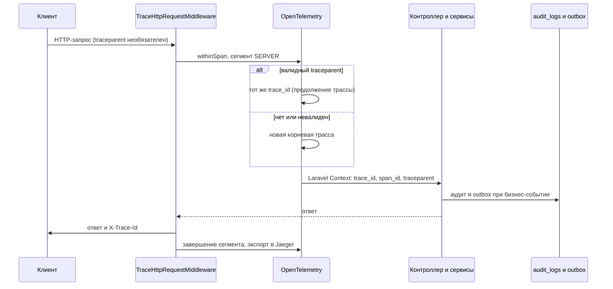

# ADR-016: Распределённая трассировка OpenTelemetry

## Статус

Принято.

## Контекст

LedgerPay: HTTP API → Redis/Horizon → обработка транзакций → transactional outbox → publisher → Kafka (Redpanda).

[ADR-015](./adr-015-prometheus-metrics.md) даёт операционные метрики, но не путь одной операции и задержки по этапам.

Есть `X-Request-Id` и журнал аудита; на границах планировщик/воркер терялся W3C-родитель сегмента.

## Решение

- OpenTelemetry PHP SDK (ручная инструментация), propagator **W3C Trace Context** (`traceparent`).
- HTTP: серверный сегмент, ответ **`X-Trace-Id`** (диагностика; родитель только из `traceparent`).
- Queue: `TraceQueuedJob` — сегмент потребителя; Laravel Context для `traceparent` при dispatch.
- Outbox: `traceparent` в headers сообщения; `PublishOutboxMessageJob` получает `traceparent` при dispatch из планировщика.
- Audit: колонки `trace_id`, `span_id` — связь с трассой, не замена политики хранения аудита.
- Логи и Problem Details: `trace_id` (без персональных данных в атрибутах сегментов).
- Метрики Prometheus **не дублируются** (`OTEL_METRICS_EXPORTER=none`); не класть `trace_id` в метки Prometheus.

Цепочка трассировки:

```text
HTTP  → TraceHttpRequestMiddleware  → серверный сегмент
      → TracingService::withinSpan  → дочерние сегменты (processor, project)
      → Context (trace_id, span_id) → аудит / логи / dispatch queue

Queue → TraceQueuedJob              → сегмент потребителя
Outbox→ PublishOutboxMessageJob     → traceparent из headers
```

На API перед `TraceHttpRequestMiddleware` выполняется `RequestIdMiddleware` (`X-Request-Id` и трассировка независимы).

### HTTP: порядок по времени

Трассировка для входящего HTTP **начинается при приёме запроса** в `TraceHttpRequestMiddleware`, до контроллера. Заголовок `traceparent` **необязателен**: при валидном значении продолжается существующая трасса, иначе создаётся новая корневая. Серверный сегмент охватывает весь конвейер (`$next($request)`): контроллер, запись в БД, постановку в очередь — до формирования ответа.

**Куда попадают данные (не путать):**

| Данные | Хранилище | Момент |
|--------|-----------|--------|
| Сегменты (длительность, дерево операций) | Jaeger (OTLP, после завершения сегмента) | Пакетный экспорт; **не** в БД приложения |
| `trace_id`, `span_id` в аудите | `audit_logs` | `INSERT` при `AuditLoggerService::log()` |
| `traceparent`, `trace_id`, `span_id` в outbox | заголовки строки outbox | INSERT при `DomainEventToOutboxMessageMapper` |

Связь: один и тот же `trace_id` в аудите и в Jaeger; запись в аудит **не ждёт** экспорта в Jaeger. Доля выборки трасс (sampling) влияет на Jaeger; на запись `trace_id` в аудит при активном контексте — нет (см. раздел Sampling).



После HTTP: воркер восстанавливает `traceparent` из Laravel Context при dispatch или из заголовков outbox у `PublishOutboxMessageJob` (граница планировщик → воркер).

### Краткая формулировка

Метрики (ADR-015) показывают **состояние** системы; распределённая трассировка — **путь одной операции**.
Перенос контекста: W3C `traceparent` через HTTP, очередь Laravel и транзакционный исходящий буфер (поле `traceparent` в заголовках сообщения).
`trace_id` и `span_id` в неизменяемом аудите — для связи с журналом, а не вместо политики хранения трасс.
Трассировка только для наблюдаемости: на платежи не влияет; метрики OpenTelemetry отключены (`OTEL_METRICS_EXPORTER=none`), идентификатор трассировки в метки Prometheus не попадает.

## Локальный стенд

- Profile **`observability`**: Jaeger UI `http://127.0.0.1:16686`, OTLP HTTP `jaeger:4318` из контейнера приложения.
- `OTEL_*` на процессе PHP (compose env), не только Laravel `.env`.

## Sampling

`parentbased_traceidratio`; журнал аудита **не зависит** от выборки трасс.

## Надёжность

Сбой экспортёра / Jaeger **не** меняет финансовое состояние. Контекст не должен перетекать между несвязанными задачами очереди.

## Безопасность

Не класть в атрибуты сегментов: токены, пароли, PAN, полные тела запросов. Входящий `traceparent` — недоверенный; при невалидном значении — новая корневая трасса.

## Связанные решения

- [ADR-015](./adr-015-prometheus-metrics.md)

## Отклонённые альтернативы

- Собственный протокол идентификаторов трассы / родителя.
- Только идентификатор корреляции без распределённой трассы.
- Laravel Telescope как замена сквозной трассировки между процессами.
