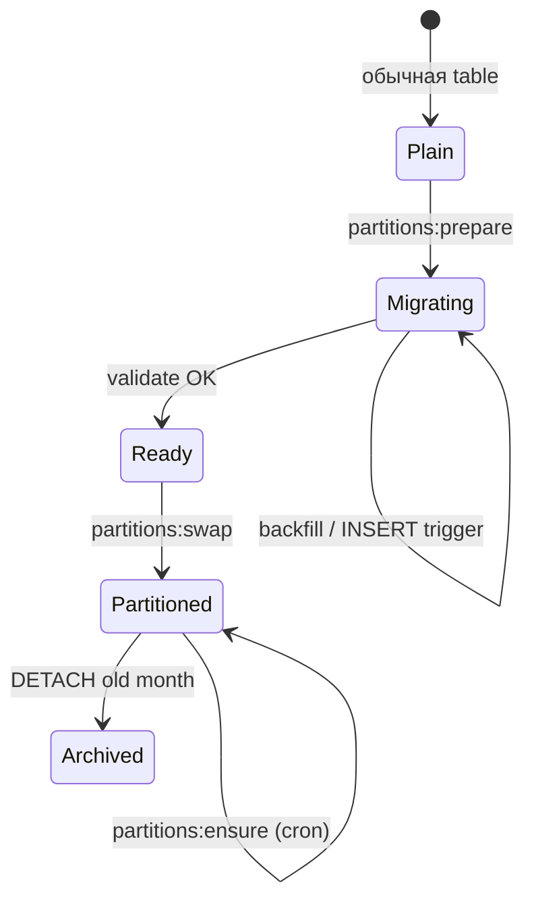
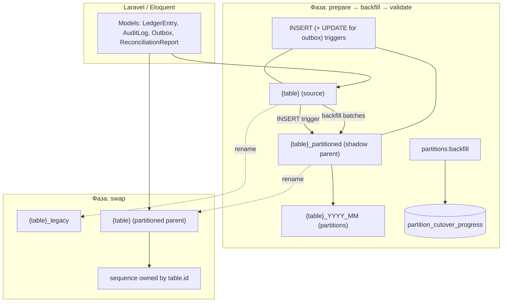
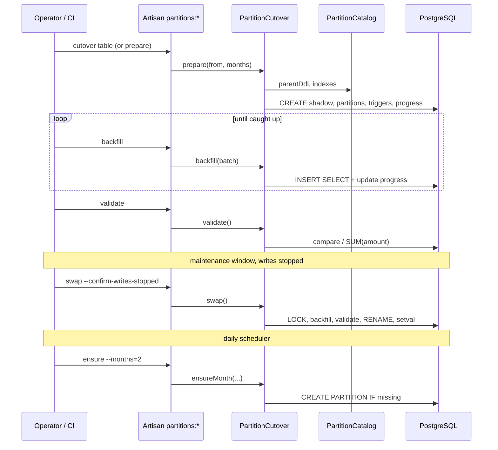
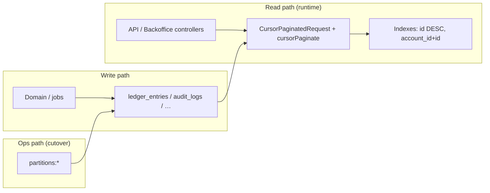

# План партиционирования (PostgreSQL)

Крупные append-only таблицы нужно партиционировать **до** того, как они станут слишком большими для комфортного обслуживания (резервное копирование, vacuum, индексы, архив).

## Кандидаты

| Таблица | Характер нагрузки |
|---------|-------------------|
| `ledger_entries` | постоянный рост, чтение по `account_id` |
| `audit_logs` | постоянный рост, compliance / расследования |
| `outbox_messages` | рост + удержание данных после публикации |
| `reconciliation_reports` | периодические срезы, история |

## Стратегия

**Range partitioning** по колонке `created_at` (UTC в приложении).

Рекомендуемый размер партиции:

- **ledger_entries**, **audit_logs**, **reconciliation_reports** — **месяц**;
- **outbox_messages** — **неделя** или **месяц** (зависит от пропускной способности и SLA удержания).

Индексы на партиции задаются **на каждой партиции отдельно** (см. `PartitionCatalog::indexStatements()`).

## Архитектура cutover в репозитории

| Слой | Назначение |
|------|------------|
| `App\Console\Partitioning\PartitionCatalog` | Явный DDL parent/shadow, порядок колонок, индексы, compare-поля для validate, флаг immutability (`outbox_messages` — mutable) |
| `App\Console\Partitioning\PartitionCutover` | `prepare` / `backfill` / `validate` / `swap` / `ensureMonth` |
| `partition_cutover_progress` | Прогресс backfill (`last_source_id`), счётчики и `validated_at` (создаётся при первом `prepare`) |
| Artisan | `partitions:prepare`, `partitions:backfill`, `partitions:validate`, `partitions:swap`, `partitions:cutover`, `partitions:ensure` |

Поддерживаемые таблицы: `ledger_entries`, `audit_logs`, `outbox_messages`, `reconciliation_reports`.

Рекомендуемый порядок первого cutover в production: `audit_logs` → `ledger_entries` → `outbox_messages` → `reconciliation_reports` (у ledger FK на `transactions`; у outbox — UPDATE статуса, не immutability).

Партиции **не включаются** обычным `migrate` — переключение выполняется осознанно на окружении (staging, затем prod).

## Почему нельзя «просто ALTER» существующую таблицу?

PostgreSQL не позволяет превратить обычную таблицу в partitioned parent одной командой без пересоздания данных. Для production с уже наполненной таблицей нужен **план онлайн-миграции** через shadow-таблицу.

### Ограничения PostgreSQL (обязательно в DDL)

- Любой `PRIMARY KEY` / `UNIQUE` на partitioned parent **должен включать ключ партиции** → `(id, created_at)` и `(uuid, created_at)` где нужно.
- Шаблон `LIKE … INCLUDING ALL` **не подходит** как единственный источник DDL: не задаёт composite PK, `DEFAULT nextval` на `id` и доменные индексы — см. `PartitionCatalog::parentDdl()`.

### Стадии миграции (shadow table)

1. **prepare** — `{table}_partitioned` (RANGE `created_at`), месячные дочерние партиции, `PRIMARY KEY (id, created_at)`, доменные индексы, `DEFAULT nextval` на `id`, INSERT-триггер в shadow; для immutable-таблиц — триггеры UPDATE/DELETE; для `outbox_messages` — триггер синхронизации UPDATE.
2. **backfill** — пакетное `INSERT … SELECT` по `id` с прогрессом в `partition_cutover_progress`; граница батча — `MAX(id)` **из исходной таблицы**, чтобы не пропустить строки, уже скопированные INSERT-триггером.
3. **validate** — missing/mismatch по полям из catalog; для `ledger_entries` — сверка `SUM(amount)`.
4. **swap** — под `LOCK TABLE … SHARE ROW EXCLUSIVE`: финальный backfill + validate, снятие триггеров, `{table}` → `{table}_legacy`, `{table}_partitioned` → `{table}`, `OWNED BY` sequence + `setval`.
5. **ensure** (после swap) — создание недостающих месячных партиций на parent; в scheduler — daily для всех четырёх таблиц.

Оркестрация без swap: `partitions:cutover` = prepare + backfill + validate (swap отдельно, с подтверждением остановки записи).

### Rollback / legacy

После swap исходные данные остаются в `{table}_legacy`. Откат — ручной (rename обратно), только если swap ещё не закреплён политикой retention и зависимостями. Перед swap — бэкап и прогон на staging.

## Состояния cutover



## Объекты PostgreSQL при миграции



## Pipeline команд



## Связь чтения (cursor) и storage



## Вопросы миграции → реализация

| Вопрос | Решение | Где |
|--------|---------|-----|
| Ключ партиции | `created_at`, RANGE, месяц | `PartitionCutover`, этот документ |
| PK / UNIQUE с partition key | `(id, created_at)`, UUID + `created_at` | `PartitionCatalog::parentDdl()` |
| FK ledger → transactions | FK на shadow parent | catalog DDL |
| Потеря строк при backfill | Прогресс по source batch max `id` | `backfill()`, `partition_cutover_progress` |
| Вставки во время миграции | AFTER INSERT trigger → shadow | `prepare()` |
| Outbox UPDATE | Sync UPDATE trigger, без immutability | `isImmutable()`, outbox triggers |
| Eloquent `create()` без ручного `id` | `DEFAULT nextval` на shadow | `prepare()` |
| Sequence после swap | `OWNED BY`, `setval` | `swap()` |
| Безопасный swap | Lock + final backfill/validate | `swap()` |
| Новые месяцы | `ensure` + advisory lock | `EnsureTablePartitionsCommand`, `routes/console.php` |

## Retention и архив

Старые партиции можно **отсоединить** (`DETACH`) и выгрузить в холодное хранилище:

```sql
ALTER TABLE ledger_entries
    DETACH PARTITION ledger_entries_2026_05;
```

После detach данные остаются в отдельной таблице — её можно архивировать или удалить по политике.

## Связь с cursor pagination

Cursor pagination по `id DESC` (см. [ADR-012](./adr-012-cursor-pagination-partitioning.md)) согласуется с индексами `(account_id, id DESC)` на партициях ledger.

## Инструменты в репозитории

Подготовка + догонка + сверка (без rename):

```bash
./vendor/bin/sail artisan partitions:cutover ledger_entries --from=2026-05 --months=12 --batch=5000
```

По шагам:

```bash
./vendor/bin/sail artisan partitions:prepare ledger_entries --from=2026-05 --months=12
./vendor/bin/sail artisan partitions:backfill ledger_entries --batch=5000
./vendor/bin/sail artisan partitions:validate ledger_entries
```

Окно обслуживания (`artisan down` или остановка INSERT):

```bash
./vendor/bin/sail artisan partitions:swap ledger_entries --confirm-writes-stopped
```

После cutover — новые месяцы (и cron в `routes/console.php`):

```bash
./vendor/bin/sail artisan partitions:ensure ledger_entries --months=2
```
