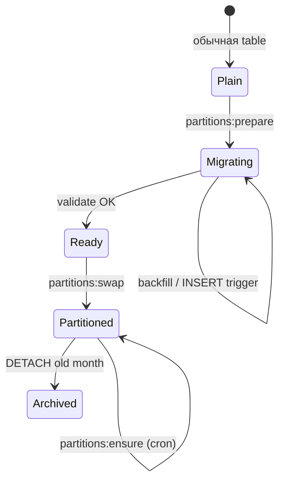
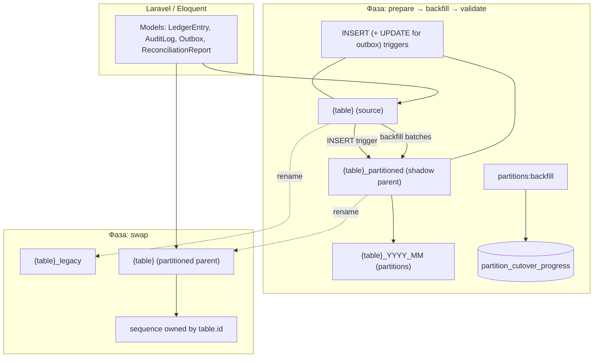
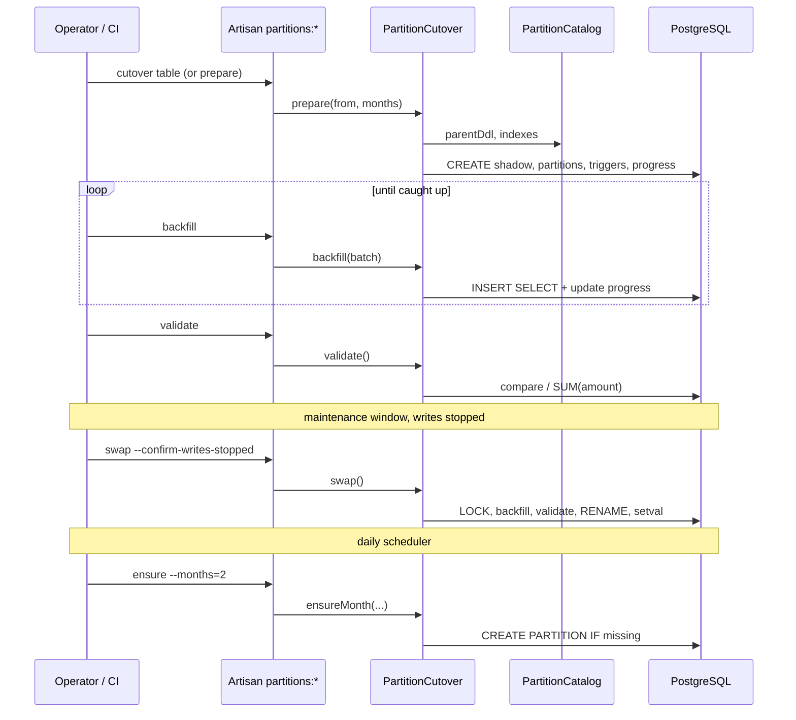
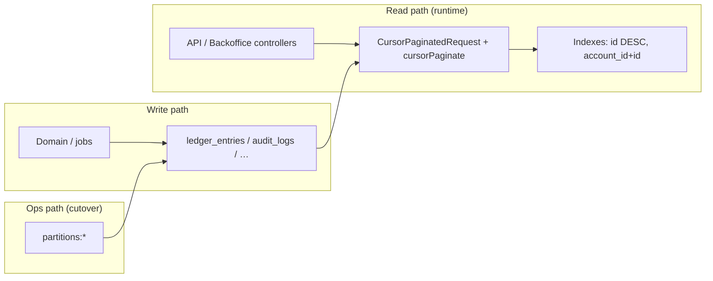

# План партиционирования (PostgreSQL)

Крупные append-only таблицы нужно партиционировать **до** того, как они станут слишком большими для комфортного обслуживания (резервное копирование, vacuum, индексы, архив).

## Кандидаты

| Таблица | Характер нагрузки |
|---------|-------------------|
| `ledger_entries` | постоянный рост, чтение по `account_id` |
| `audit_logs` | постоянный рост, compliance / расследования |
| `outbox_messages` | рост + удержание данных после публикации |
| `reconciliation_reports` | периодические срезы, история |

## Стратегия

**Партиционирование по диапазонам** колонки `created_at` (UTC в приложении).

Рекомендуемый размер партиции:

- **ledger_entries**, **audit_logs**, **reconciliation_reports** — **месяц**;
- **outbox_messages** — **неделя** или **месяц** (зависит от пропускной способности и SLA удержания).

Индексы на партиции задаются **на каждой партиции отдельно** (см. `PartitionCatalog::indexStatements()`).

## Архитектура переключения в репозитории

| Слой | Назначение |
|------|------------|
| `App\Console\Partitioning\PartitionCatalog` | Явный DDL родительской и теневой таблиц, порядок колонок, индексы, поля сравнения для стадии `validate`, признак неизменяемости (`outbox_messages` допускает изменения) |
| `App\Console\Partitioning\PartitionCutover` | `prepare` / `backfill` / `validate` / `swap` / `ensureMonth` |
| `partition_cutover_progress` | Ход пакетного переноса (`last_source_id`), счётчики и `validated_at` (создаётся при первом `prepare`) |
| Artisan | `partitions:prepare`, `partitions:backfill`, `partitions:validate`, `partitions:swap`, `partitions:cutover`, `partitions:ensure` |

Поддерживаемые таблицы: `ledger_entries`, `audit_logs`, `outbox_messages`, `reconciliation_reports`.

Рекомендуемый порядок первого переключения в боевом окружении: `audit_logs` → `ledger_entries` → `outbox_messages` → `reconciliation_reports` (у реестра проводок есть внешний ключ на `transactions`; у исходящих сообщений изменяется статус, поэтому они не являются неизменяемыми).

Партиции **не включаются** обычным `migrate` — переключение выполняется осознанно в тестовом, а затем в боевом окружении.

## Почему нельзя «просто ALTER» существующую таблицу?

PostgreSQL не позволяет превратить обычную таблицу в партиционированную родительскую одной командой без пересоздания данных. Для боевого окружения с уже наполненной таблицей нужен **план переноса без остановки записи** через теневую таблицу.

### Ограничения PostgreSQL (обязательно в DDL)

- Любой `PRIMARY KEY` / `UNIQUE` на партиционированной родительской таблице **должен включать ключ партиции** → `(id, created_at)` и `(uuid, created_at)` где нужно.
- Шаблон `LIKE … INCLUDING ALL` **не подходит** как единственный источник DDL: не задаёт составной первичный ключ, `DEFAULT nextval` на `id` и предметные индексы — см. `PartitionCatalog::parentDdl()`.

### Стадии переноса (теневая таблица)

1. **`prepare`** — `{table}_partitioned` (RANGE `created_at`), месячные дочерние партиции, `PRIMARY KEY (id, created_at)`, предметные индексы, `DEFAULT nextval` на `id`, INSERT-триггер в теневой таблице; для неизменяемых таблиц — триггеры UPDATE/DELETE; для `outbox_messages` — триггер синхронизации UPDATE.
2. **`backfill`** — пакетное `INSERT … SELECT` по `id` с записью хода переноса в `partition_cutover_progress`; граница пакета — `MAX(id)` **из исходной таблицы**, чтобы не пропустить строки, уже скопированные INSERT-триггером.
3. **`validate`** — поиск отсутствующих и различающихся строк по полям из каталога; для `ledger_entries` — сверка `SUM(amount)`.
4. **`swap`** — под `LOCK TABLE … SHARE ROW EXCLUSIVE`: финальный пакетный перенос и сверка, снятие триггеров, `{table}` → `{table}_legacy`, `{table}_partitioned` → `{table}`, передача последовательности через `OWNED BY` и вызов `setval`.
5. **`ensure`** (после `swap`) — создание недостающих месячных партиций на родительской таблице; планировщик выполняет эту стадию ежедневно для всех четырёх таблиц.

Последовательность без переключения: `partitions:cutover` = `prepare` + `backfill` + `validate` (стадия `swap` запускается отдельно, с подтверждением остановки записи).

### Откат и исходная таблица

После стадии `swap` исходные данные остаются в `{table}_legacy`. Откат выполняется вручную обратным переименованием, только если переключение ещё не закреплено политикой хранения и зависимостями. Перед переключением нужны резервная копия и пробный запуск в тестовом окружении.

## Состояния переключения



## Объекты PostgreSQL при миграции



## Последовательность команд



## Связь курсорного чтения и хранения



## Вопросы миграции → реализация

| Вопрос | Решение | Где |
|--------|---------|-----|
| Ключ партиции | `created_at`, RANGE, месяц | `PartitionCutover`, этот документ |
| PK / UNIQUE с ключом партиции | `(id, created_at)`, UUID + `created_at` | `PartitionCatalog::parentDdl()` |
| Внешний ключ реестра → transactions | Внешний ключ на теневой родительской таблице | DDL каталога |
| Потеря строк при пакетном переносе | Ход переноса по максимальному `id` пакета исходной таблицы | `backfill()`, `partition_cutover_progress` |
| Вставки во время переноса | AFTER INSERT-триггер → теневая таблица | `prepare()` |
| UPDATE исходящих сообщений | Триггер синхронизации UPDATE, без запрета изменений | `isImmutable()`, триггеры исходящих сообщений |
| Eloquent `create()` без ручного `id` | `DEFAULT nextval` на теневой таблице | `prepare()` |
| Последовательность после переключения | `OWNED BY`, `setval` | `swap()` |
| Безопасное переключение | Блокировка, финальный пакетный перенос и сверка | `swap()` |
| Новые месяцы | `ensure` + рекомендательная блокировка | `EnsureTablePartitionsCommand`, `routes/console.php` |

## Retention и архив

Старые партиции можно **отсоединить** (`DETACH`) и выгрузить в холодное хранилище:

```sql
ALTER TABLE ledger_entries
    DETACH PARTITION ledger_entries_2026_05;
```

После отсоединения данные остаются в отдельной таблице — её можно архивировать или удалить по политике.

## Связь с курсорной пагинацией

Курсорная пагинация по `id DESC` (см. [ADR-012](./adr-012-cursor-pagination-partitioning.md)) согласуется с индексами `(account_id, id DESC)` на партициях реестра проводок.

## Инструменты в репозитории

Подготовка + догонка + сверка (без rename):

```bash
./vendor/bin/sail artisan partitions:cutover ledger_entries --from=2026-05 --months=12 --batch=5000
```

По шагам:

```bash
./vendor/bin/sail artisan partitions:prepare ledger_entries --from=2026-05 --months=12
./vendor/bin/sail artisan partitions:backfill ledger_entries --batch=5000
./vendor/bin/sail artisan partitions:validate ledger_entries
```

## Эксплуатационная инструкция: переключение

`artisan down` останавливает HTTP-трафик, но не обработчики Horizon, планировщик, отдельные процессы CLI и импорта, а также внешние источники сообщений. Перед `partitions:swap` нужно остановить **все** источники записи в переключаемую таблицу:

| Источник записи | Действие |
|-----------------|----------|
| HTTP/API | Laravel maintenance mode (`artisan down`) |
| Задания Horizon | `horizon:pause`, затем дождаться завершения активных заданий |
| Планировщик | остановить `schedule:work` или временно отключить cron/CronJob `schedule:run` |
| Отдельные обработчики, CLI и процессы импорта | остановить через диспетчер процессов или систему управления |
| Внешние источники сообщений | приостановить на время переключения |

Для `ledger_entries` критичны обработчики транзакций; для `outbox_messages` — отправитель и источники сообщений; для `reconciliation_reports` — планировщик; запись в `audit_logs` может выполняться из HTTP-запросов и заданий.

### 1. Предварительная проверка

```bash
./vendor/bin/sail artisan partitions:validate ledger_entries
```

Проверить `validated_at`, счётчики и ход переноса можно через Tinker:

```bash
./vendor/bin/sail artisan tinker \
  --execute="dump(DB::table('partition_cutover_progress')->where('table_name', 'ledger_entries')->first());"
```

Или напрямую через PostgreSQL CLI:

```bash
./vendor/bin/sail psql
```

```sql
SELECT *
FROM partition_cutover_progress
WHERE table_name = 'ledger_entries';
```

Интерпретация:

- `validated_at IS NOT NULL` — последняя команда `partitions:validate` завершилась успешно;
- `source_count = shadow_count` — на момент этой проверки количество строк совпадало;
- `last_source_id` — граница пакетного переноса, а не обязательно текущий `MAX(id)`: более новые строки могли уже попасть в обе таблицы через INSERT-триггер.

Ход переноса — диагностический снимок, а не замена финальной проверки. Пока источники записи работают, данные могут измениться после чтения этой строки; `partitions:swap` под блокировкой самостоятельно повторяет пакетный перенос и сверку.

Перед переключением в боевом окружении обязательны резервная копия и пробный запуск в тестовом окружении.

### 2. Остановить HTTP и фоновые записи

```bash
./vendor/bin/sail artisan down --retry=60
./vendor/bin/sail artisan horizon:pause
./vendor/bin/sail artisan horizon:status
```

`horizon:pause` не прерывает уже выполняющееся задание: нужно дождаться завершения активных заданий через интерфейс или средства наблюдения Horizon. Команда `horizon:status` возвращает код завершения `1` для ожидаемого состояния `paused`; в сценарии оболочки с `set -e` используйте:

```bash
./vendor/bin/sail artisan horizon:status || true
```

У планировщика нет универсальной команды `schedule:pause`: остановите процесс `schedule:work` либо временно отключите cron/CronJob, запускающий `schedule:run`.

Если нужна полная штатная остановка Horizon, сначала отключите его автоматический перезапуск в диспетчере процессов, затем выполните:

```bash
./vendor/bin/sail artisan horizon:terminate --wait
```

Для обычного переключения предпочтительнее `horizon:pause` / `horizon:continue`.

### 3. Переключить таблицу

```bash
./vendor/bin/sail artisan partitions:swap ledger_entries \
    --confirm-writes-stopped
```

Стадия `swap` под блокировкой повторяет финальный пакетный перенос и сверку, меняет имена таблиц, передаёт последовательность новой родительской таблице и выполняет `setval`. `{table}_legacy` не следует удалять до окончания периода наблюдения.

### 4. Проверить будущие партиции

```bash
./vendor/bin/sail artisan partitions:ensure ledger_entries --months=2
```

После стадии `swap` планировщик ежедневно запускает эту команду для всех четырёх таблиц.

### 5. Проверка работоспособности и возобновление

Проверить чтение, создание новой записи, курсорную пагинацию, последовательность и наличие партиции для текущего месяца. Затем:

```bash
./vendor/bin/sail artisan horizon:continue
./vendor/bin/sail artisan up
```

После проверки работоспособности отдельно запустить планировщик и остальные остановленные источники сообщений.

> `./vendor/bin/sail up -d` запускает Docker-контейнеры, а `./vendor/bin/sail artisan up` выключает Laravel maintenance mode. Это разные команды.

В боевом окружении вместо Sail используйте `php artisan` внутри рабочего контейнера и команды диспетчера процессов или системы управления (systemd, Docker Compose, Kubernetes) для остановки обработчиков и планировщика.
